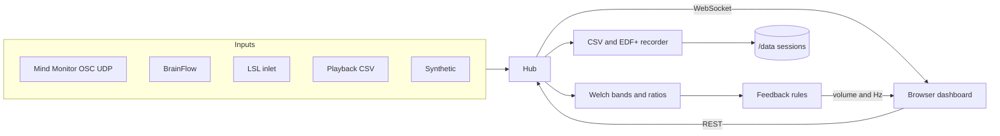

# LiminalGate

Open, self-hosted neuro gateway for live EEG recording, custom brainwave bands, markers, and biofeedback across brain-state transitions. It is generic: any band name and any frequency range, not a single-band tool.

v0.1 runs as one container. A browser on the same LAN (laptop, phone, or a TV) shows the live dashboard. The default input is a synthetic theta-dominant signal, so the app is usable with no headset. Mind Monitor OSC is the hardware path that must work.

No telemetry. An optional access token can close the LAN API.

## Quick start

```bash
docker compose up --build
```

Open `http://<this-machine>:8080`. With the default synthetic input you should see four traces, a spectrum, band bars, a theta/delta ratio, and a heart-rate estimate within a few seconds.

Click **Enable tone** once (browsers block audio until a click). The hypnagogic profile maps the 5.5–6 Hz peak onto a tone and fades it if alpha relative power gets high. The readout under the ratios shows `Tone on · Hz · volume %`.

Click **Record**, wait a few seconds, click **Stop**. The session lands in the `liminalgate-data` volume as CSV plus EDF+ (markers are EDF+ annotations). Copy it out with:

```bash
docker compose cp liminalgate:/data ./recordings
```

Or bind-mount a folder instead of the named volume:

```yaml
volumes:
  - ./recordings:/data
```

The directory must be writable by uid 1000.

To publish only on this machine:

```bash
LIMINALGATE_BIND_WEB=127.0.0.1:8080:8080 \
LIMINALGATE_BIND_OSC=127.0.0.1:5000:5000/udp \
docker compose up --build
```

### Mind Monitor OSC

1. On the phone, open Mind Monitor and set **OSC Stream Target** to the IP of the computer running LiminalGate and port **5000** (UDP).
2. In the dashboard, open **Setup**, set Input to `osc`, and click **Apply**. UDP 5000 is published even while the synthetic input is selected, so you do not have to recreate the container to switch.
3. The expected paths are `/muse/eeg` (TP9, AF7, AF8, TP10, optional AUX, µV), `/muse/acc`, `/muse/gyro`, `/muse/ppg`, `/muse/elements/*_absolute`, `/muse/elements/horseshoe`, `/muse/elements/blink`, `/muse/elements/jaw_clench`, and `/Marker/1` … `/Marker/5`. See the [Mind Monitor FAQ](https://mind-monitor.com/FAQ.php). Horseshoe 1 is good, 2 is medium, 4 is bad; 3 is treated as poor. Channels with horseshoe ≥ 4 are left out of the mean.

### Playback

`examples/demo.csv` is eight seconds of the synthetic mix in Mind Monitor column names, with a marker on the 2 second row. In Setup set Input to `playback`, Playback file to the path inside the container (copy the file into `/data` first), and Apply.

## Architecture



One input runs at a time. Samples go through a ring buffer. A sliding Welch PSD produces absolute power in µV² and relative power over a configurable range (default 1–45 Hz). The spectrum chart uses a 4 s segment with 50% overlap on the good EEG channels only, from 1–45 Hz. Band edges are inclusive, so a 5.5–6 Hz band contains the 6 Hz bin. Ratio expressions such as `theta/delta` use a small parser (no `eval`). The browser gets a decimated display stream; recording keeps every raw sample.

The EEG chart is filtered for display only: a causal high-pass at 1 Hz, a low-pass at 45 Hz, and a notch at the configured powerline. **Filtered** is the default (Mind Monitor's view). **Raw** is the unfiltered ADC. AUX channels are kept on the trace and left out of bands and the spectrum. A channel is also left out when horseshoe or `is_good` says it is bad, when it is flat, or when samples sit on the ADC rail (near 0 µV, or at the top of the range). Athena's 14-bit rail is about 1450 µV; the older FAQ range tops out at 1682 µV. The ~800 µV baseline on an unfiltered trace is that unsigned midpoint, not a scale error.

The top chart is absolute band power over time for delta, theta, alpha, beta, and gamma, in log10 µV² (Bels), averaged over the good channels. If Mind Monitor is also sending `/muse/elements/*_absolute`, those device values are drawn as dashed lines. OSC bursts are paced on a 1/fs sample clock so a packet of samples is not stacked on one timestamp, and a real pause becomes a gap in the line instead of a straight stroke across it.

Markers come from the buttons, hotkeys, `POST /api/markers`, and OSC `/Marker/N`. Blink and jaw clench are separate event types, debounced to 300 ms.

Profiles (bands, ratios, markers, feedback rules) are YAML. Three ship with the app: `classic`, `hypnagogic` (5.5–6 Hz peak and theta/delta), and `alpha_relaxation`. Saving from the UI writes `data/profiles/<name>.yaml`, which overrides a builtin of the same name. Delete the file to restore the builtin.

Biofeedback plays in the browser with Web Audio. Host audio via `aplay` is off unless you enable **Host speaker** in Setup. If `aplay` is missing, that toggle turns itself back off.

## Sessions

```
data/dataset_description.json
data/sub-<subject>/ses-<YYYYMMDDTHHMMSS>/
  session.json
  eeg/sub-..._task-<task>_eeg.csv
  eeg/sub-..._task-<task>_eeg.edf
  eeg/sub-..._task-<task>_eeg.json
  eeg/sub-..._task-<task>_channels.tsv
  eeg/sub-..._events.tsv
  motion/  acc.csv gyro.csv
  physio/  ppg.csv optics.csv
```

`session.json` records the device settings, the profile, notes, and `eeg_scale`. XDF is not written in v0.1 (see the TODO in `liminalgate/recording.py`).

Powerline frequency is metadata in the session and the frequency of the display notch. Recorded EEG is not filtered.

## Microvolt scale

Muse Athena µV values can differ between BrainFlow and muse-lsl by about 4.5×. LiminalGate does not hard-code a correction. Set **EEG scale** in Setup (or `LIMINALGATE_EEG_SCALE`). The factor is applied once, at the input, and stored in the session metadata. The default is `1.0`.

## Configuration

Environment prefix `LIMINALGATE_`. `LIMINALGATE_INPUT` is accepted as an alias of `LIMINALGATE_INPUT_TYPE`.

| Variable | Default | Role |
| --- | --- | --- |
| `LIMINALGATE_INPUT` | `synthetic` | `synthetic`, `osc`, `playback`, `brainflow`, `lsl` |
| `LIMINALGATE_TOKEN` | empty | When set, REST and the WebSocket require `Authorization: Bearer`, `X-Liminal-Token`, or `?token=` |
| `LIMINALGATE_EEG_SCALE` | `1.0` | Multiplier for raw EEG |
| `LIMINALGATE_EEG_FS` | `256` | Nominal EEG rate until a stream reports its own |
| `LIMINALGATE_OSC_PORT` | `5000` | UDP listen port |
| `LIMINALGATE_DATA_DIR` | `data` | Sessions, profiles, saved UI config |
| `LIMINALGATE_POWERLINE_HZ` | `50` | Metadata only |

The Setup panel writes `data/config.json`. On the next start that file overrides the environment for the fields the UI can change (not the token, host, or port). `/api/health` and the static dashboard stay open when a token is set. API docs: `/docs`.

Put the token in the browser once via Setup. It is kept in `localStorage` on that browser.

## BrainFlow and LSL

Both libraries are installed in the image and imported only when that input is selected. BLE and LSL multicast do not cross the default Docker bridge. Use host networking:

```bash
docker compose -f compose.yaml -f compose.host.yaml up --build
```

That mounts `/var/run/dbus` and puts the process on the host network. The app then listens on port 8080 and UDP 5000 directly. BrainFlow board names: `synthetic`, `muse_s_athena` (also the older `MUSE_S_ANTHENA_BOARD` spelling), `muse_2`, `muse_s`, `muse_2016`. A missing Athena id asks you to upgrade BrainFlow.

The LSL input reads one EEG inlet. Marker inlet, clock correction, and irregular rate 0 are still TODO.

## Develop without Docker

```bash
python -m pip install -r requirements.txt -r requirements-dev.txt
cd frontend && npm ci && npm run build && cd ..
python -m liminalgate
```

`websockets` is a direct dependency. The live dashboard socket needs it; a plain `uvicorn` install does not pull it in.

For UI work, run the API on 8080 and `npm run dev` in `frontend` (Vite proxies `/api` and `/ws`).

```bash
ruff check liminalgate tests
ruff format --check liminalgate tests
pytest
```

NumPy is pinned to 1.26.4 and SciPy to 1.14.1 so the wheels stay on baseline manylinux with runtime CPU dispatch. A 2012 Ivy Bridge CPU has AVX and not AVX2; newer NumPy wheels that require x86-64-v3 will not load there.

## Roadmap

- XDF writer
- LSL marker inlet and clock sync
- BrainFlow preset toggles in the UI
- More than one input at a time (for example EEG over OSC and a separate PPG stream)
- A real notch / bandpass, still off unless a profile asks for it

## License

MIT. Copyright 2026 Ivica Lovrić.
